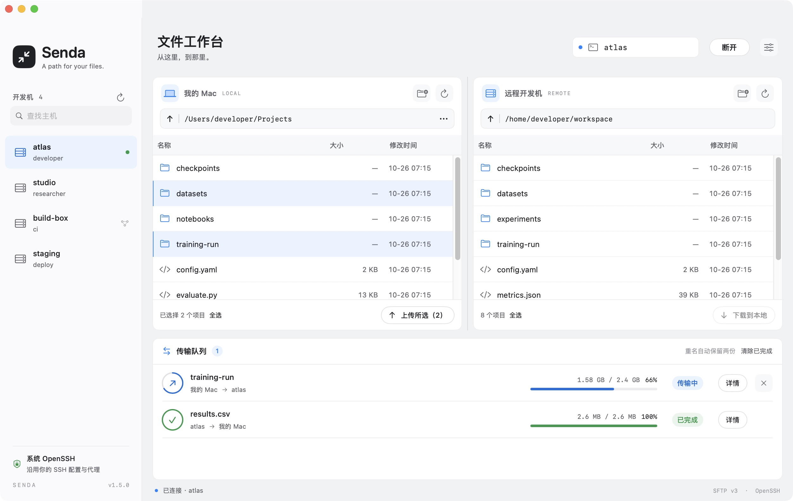
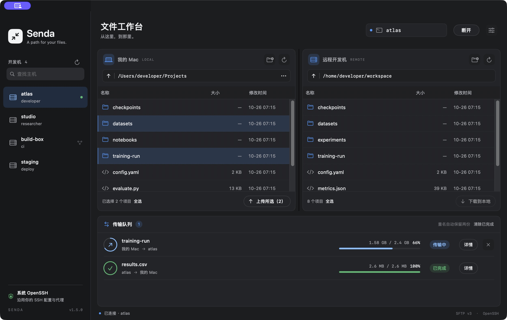
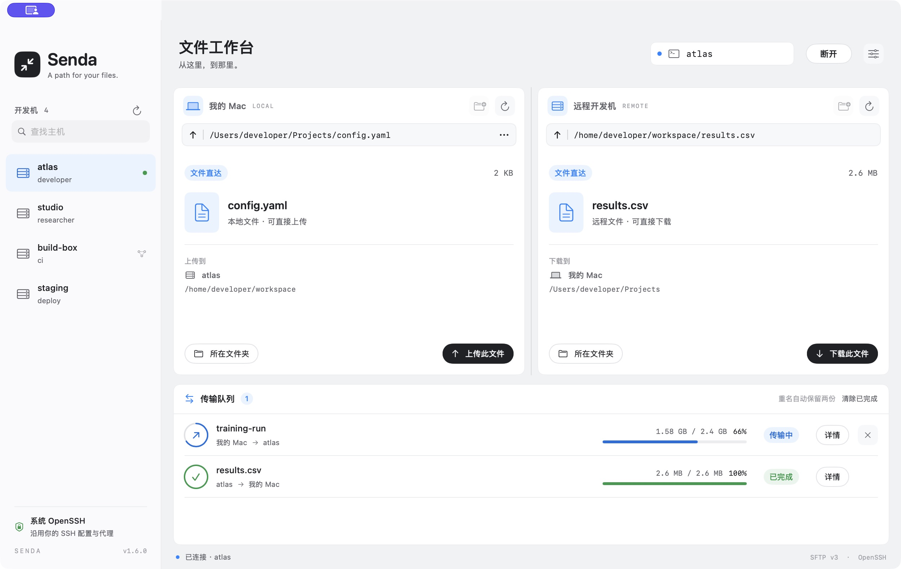
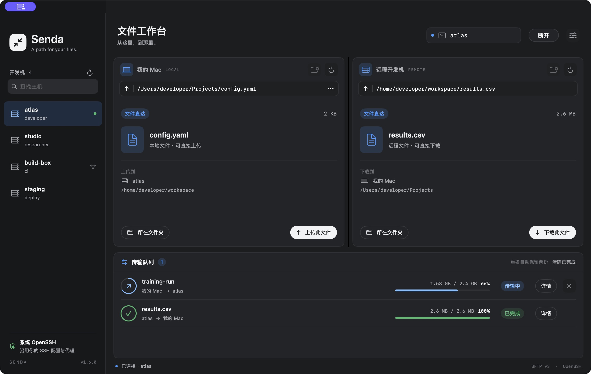
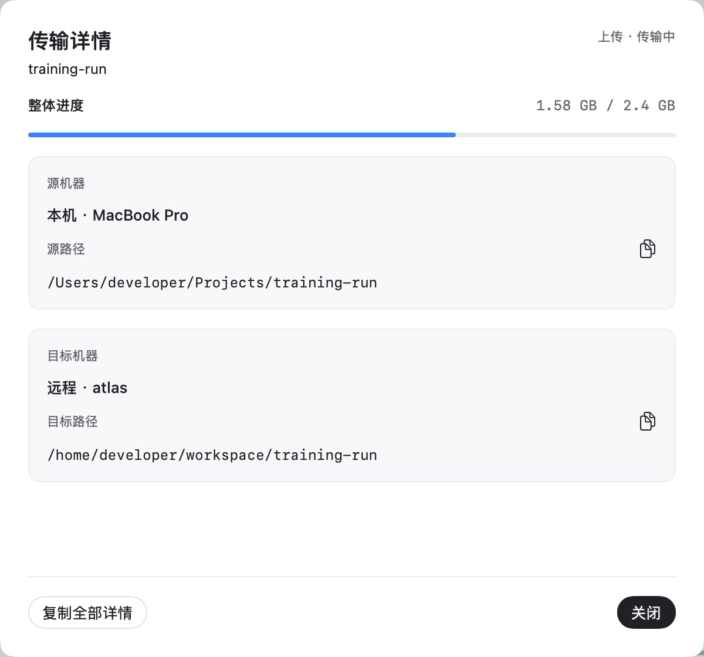

# Senda

**A path for your files.** A free, native macOS SFTP app that works with your existing SSH configuration — including `ProxyCommand` and `ProxyJump`.

[Download](https://github.com/qingchanghan/senda-sftp/releases/latest) · [简体中文](README.zh-CN.md) · [Contributing](CONTRIBUTING.md) · [Changelog](CHANGELOG.md) · [MIT license](LICENSE)



<details>
<summary>Dark appearance / 深色外观</summary>



</details>

## Why Senda?

- **Your SSH setup, in a window.** Uses `/usr/bin/ssh` for authentication, proxies, keys and host verification.
- **Drag in either direction.** Upload from Finder; download to Finder, Desktop or the local pane. Select multiple files and folders with ⌘/⇧.
- **Go straight to a file.** Paste its path into either address bar to inspect it and upload/download with one click.
- **Whole-folder progress.** Sums regular files throughout the directory before transferring, then shows cumulative bytes and percentage.
- **Inspectable transfers.** View and copy the source machine/path and the resolved destination, including automatic collision renaming.
- **Responsive by design.** Native virtualized file tables, independent browsing and transfer connections, throttled per-task progress and connection reuse.
- **Light and dark.** Native adaptations of [Beautiful UI](https://www.beautifului.dev/) with one shared token palette. [Attribution and source mapping](THIRD_PARTY_NOTICES.md).

## Download

Get `Senda-macOS-arm64.dmg` from [GitHub Releases](https://github.com/qingchanghan/senda-sftp/releases/latest).
Open the disk image and drag `Senda.app` onto Applications, then eject the image.
Requires Apple silicon and macOS 13+. A ZIP download is also available.
The current build is ad hoc signed and has not been notarized by Apple.
Intel users can build from source; Intel hardware has not yet been verified.

## Build and run

Requires macOS 13+, Apple Command Line Tools with Swift 5.9+ (or Xcode), and Python 3 for the design-token check. No Node, Electron or third-party runtime dependencies.

```bash
xcode-select --install  # only if Command Line Tools are not installed
git clone https://github.com/qingchanghan/senda-sftp.git
cd senda-sftp
./scripts/build-app.sh
open dist/Senda.app
```

The script builds with two jobs and creates `dist/Senda.app` plus a DMG and ZIP for
the build machine's architecture. Drag the app to Applications if desired. Local
builds are ad hoc signed, not Developer ID signed or notarized. The initial release
has been verified on Apple silicon; Intel has not yet been verified.

Upgrading from Harbor imports the saved host, paths, hidden-file setting and proxy
PATH once. The old preference domain is left intact.

## Connect

First ensure `ssh dev-box` works in Terminal. Add an alias to `~/.ssh/config`, for example:

```sshconfig
Host dev-box
    HostName dev.example.com
    User developer
    ProxyCommand /absolute/path/to/your-proxy %h %p
```

Select the alias in Senda's sidebar or type it into the connection field. The first
connection opens the remote login directory; subsequent connections restore the
last valid location. OpenSSH evaluates your complete config, including `Match`,
wildcards, `Include`, identities and proxies. Sidebar hints are only a lightweight
preview of that configuration.

If your proxy needs a specific Python or other runtime, set its **bin directory**
in connection settings. Senda adds common Conda, Homebrew and `~/.local/bin` paths.
SSH passwords, key passphrases and host verification use a native askpass dialog;
Senda does not store passwords or change your SSH configuration.

## Transfer files

Use the left pane for local files and the right for remote files. Double-click a
folder or enter a path and press Return. Drag selections between panes, onto a
folder row, or from the remote pane to Finder. You can also use the upload/download
buttons. Double-clicking a remote regular file downloads it to the local pane.

You can also paste a **full file path** into either address bar and press Return.
Senda shows the file's name, size and destination, with an **Upload this file** or
**Download this file** button. Choose **Containing folder** to return to browsing.
The destination is the other pane's current directory; when that pane also shows
a file, its parent directory is used. Existing names still get a collision suffix.
Resolving an address does not start a transfer automatically.

Relative paths use the pane's current directory. Local `file://` URLs and `~`
paths work; remote `~/` uses the remote login directory. Explicit hidden files
work without changing the hidden-file preference, and their parent does not need
to be listable. Symlinks to files and special files remain unsupported.



<details>
<summary>File addresses in dark appearance</summary>



</details>

| Shortcut | Action |
| --- | --- |
| ⌘K | Connect |
| ⌘R | Refresh |
| ⌘O | Choose local directory |
| ⇧⌘. | Show/hide hidden files |
| ⌘A / ⇧⌘A | Select all / clear selection in the focused file table |
| Return | Open the selected folder |

A folder first displays “计算大小” (calculating size), then a fixed total across
all regular descendants. Each queued item has its own overall progress. Existing
names get a suffix such as ` (2)`; completed files are committed from temporary
siblings. Details remain available until the queue is cleared or the app closes.
The current application interface is in Simplified Chinese.



## Boundaries

- SFTP v3 and UTF-8 filenames. The remote SSH server must provide an SFTP subsystem.
- Directory contents are scanned once. Size changes detected afterward fail the
  transfer; this is not a filesystem snapshot or a checksum-verifying sync tool.
- Symlinks inside directories are skipped; individually selected symlinks and
  special files are rejected. Permissions are transferred for regular files;
  ownership, timestamps, extended attributes and ACLs are not preserved.
- Cancellation/failure can leave completed children and directories. An interrupted
  connection or force quit can leave `.senda-<UUID>.part` files. No resume, directory
  merge, remote deletion or synchronization is implemented.
- The queue runs sequentially. A file uses a window of 16 × 32 KiB SFTP requests.
  Credentials and proxy policy are still controlled by your system SSH setup.

## Development

```bash
swift build --product Senda -j 2
./scripts/check.sh
# Optional: exercise SSH and ProxyCommand using disposable /tmp fixtures
.build/debug/Senda --batch-checks dev-box
# Read-only remote diagnostic
.build/debug/Senda --probe dev-box /remote/path
# Offline screenshot fixtures (no SSH or user files)
open dist/Senda.app --args --demo
open dist/Senda.app --args --demo --dark
open dist/Senda.app --args --demo --demo-file
```

See [architecture and design tokens](docs/architecture.md), [verification](docs/verification.md)
and [release preparation](docs/releasing.md). Local protocol checks use macOS's
`/usr/libexec/sftp-server`; Remote Login does not need to be enabled. Remote tests
are opt-in and never run in CI.

## License

Senda is MIT licensed. Beautiful UI adaptations retain their original MIT notice
in [THIRD_PARTY_NOTICES.md](THIRD_PARTY_NOTICES.md). Screenshots use synthetic hosts,
paths and transfers.
